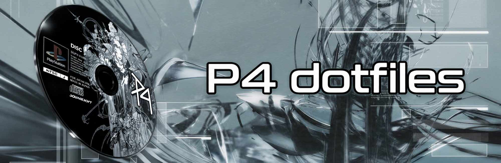

<div align="center">

# 🌌 Dotfiles de P4PUNN0 (Dorfiles-P4)



<p align="center">
  
  
  
  
  
</p>

<b><a href="#-características">Características</a> · <a href="#-atajos-de-teclado">Atajos</a> · <a href="#-wallpapers">Wallpapers</a> · <a href="#-instalación">Instalación</a> · <a href="#-estructura">Estructura</a></b>

</div>

---


## 📖 Descripción General

Este repositorio contiene la configuración completa, minimalista y productiva para un entorno de escritorio basado en **Wayland**, utilizando **Hyprland** como gestor de ventanas (tiling window manager) y **Quickshell** como motor principal de la interfaz visual (barra de estado, centro de control, selectores y menús).

El entorno combina una estética moderna con colores dinámicos generados automáticamente a partir del fondo de pantalla seleccionado, efectos de desenfoque (blur), opacidad equilibrada y atajos pensados para flujo de trabajo y desarrollo.

---

## ✨ Características

- 🪟 **Hyprland (v0.57+)**: Configuración optimizada con distribución de teclado en español latinoamericano (`latam`), opacidad de ventanas de `0.9` para una estética limpia sin perder legibilidad, y transiciones fluidas.
- ⚡ **Quickshell**:
  - **Barra superior**: Barra modular con indicadores interactivos de red, volumen, batería, workspaces y reloj.
  - **Centro de Control / Sidepanel**: Ajustes rápidos de Wi-Fi, Bluetooth, brillo, modo oscuro/claro y atajos.
  - **Grabador de pantalla integrado**: OSD rápido con opciones de escala, opacidad y layout con clic derecho.
  - **Selector de Fondos (hyprquickpaper)**: Menú visual para previsualizar y aplicar wallpapers estáticos y animados en tiempo real.
- 🎨 **Theming Dinámico con Matugen**: Extracción automática de paletas Material You a partir de la imagen de fondo, aplicando coherencia visual a Kitty, Hyprland, Rofi y la barra.
- 💻 **Terminal Kitty**:
  - Integración nativa con los temas generados por Matugen.
  - Espaciado interno acolchado (`window_padding_width 15`).
  - Cursor estilo haz con parpadeo suave.
- 🐚 **Zsh + Starship**:
  - Prompt moderno, rápido e informativo.
  - Autocompletado, historial interactivo y resaltado de sintaxis.
- 📊 **Fastfetch Personalizado**:
  - Logo en arte ASCII propio.
  - Resumen visual con detalles de procesador, GPU, memoria, kernel y paleta de colores en círculos.
- 🖼️ **Soporte de Fondos Animados (Live Wallpapers)**:
  - Integración con `mpvpaper`.
  - Script inteligente de ahorro de recursos (`live-wallpaper-pause.sh`) que pausa automáticamente la reproducción de video cuando hay ventanas abiertas o activas en el espacio de trabajo.
- 🚀 **Lanzador Rofi & Portapapeles**:
  - Búsqueda veloz de aplicaciones (`rofi -show drun`).
  - Gestor de historial de portapapeles (`cliphist`).
- 🔒 **Pantalla de Bloqueo (Hyprlock)**: Bloqueo elegante con reloj tipográfico y campo de contraseña centrado con colores dinámicos.

---

## ⌨️ Atajos de Teclado (Keybinds)

> [!TIP]
> La tecla **Super** corresponde habitualmente a la tecla `Windows` de tu teclado.  
> Los atajos también se pueden personalizar directamente desde la interfaz gráfica de **Quickshell** en `Ajustes` (`Super + I`) → `Keybinds`.

### 🚀 Aplicaciones y Utilidades

| Atajo | Acción |
|---|---|
| `Super + T` | Abrir terminal (**Kitty**) |
| `Super + C` | Abrir editor de código (**Visual Studio Code**) |
| `Super + B` | Abrir navegador web predeterminado |
| `Super + E` | Abrir gestor de archivos (**Thunar**) |
| `Super + D` | Lanzador de aplicaciones (**Rofi**) |
| `Super + W` | Selector de fondos de pantalla (**Wallpaper picker**) |
| `Super + N` | Abrir panel lateral / Centro de acciones |
| `Super + I` | Menú de ajustes del sistema |
| `Super + V` | Historial del portapapeles |
| `Super + Grave` (`~` o `` ` ``) | Menú de apagado / cerrar sesión (Powermenu) |
| `Super + Tab` | Bloquear pantalla (**Hyprlock**) |

### 🪟 Gestión de Ventanas y Workspaces

| Atajo | Acción |
|---|---|
| `Super + Q` | Cerrar ventana activa |
| `Super + Space` | Alternar modo flotante en la ventana activa |
| `Super + F` | Pantalla completa (Fullscreen) |
| `Super + O` | Alternar opacidad de la ventana |
| `Super + H / J / K / L` | Mover el foco entre ventanas (Izquierda, Abajo, Arriba, Derecha) |
| `Super + Shift + H / J / K / L` | Mover la ventana activa en la dirección deseada |
| `Super + 1 .. 9, 0` | Cambiar al espacio de trabajo (Workspace) 1..10 |
| `Super + Shift + 1 .. 9, 0` | Mover la ventana activa al workspace 1..10 |
| `Super + Clic Izquierdo (arrastrar)` | Mover ventana flotante |
| `Super + Clic Derecho (arrastrar)` | Redimensionar ventana |

### 📸 Capturas y Herramientas

| Atajo | Acción |
|---|---|
| `Print` / `Delete` | Captura de pantalla completa |
| `Shift + Print` / `Shift + Delete` | Captura de pantalla por área seleccionada |
| `Super + R` | Alternar grabador de pantalla integrado |
| `Super + Shift + C` | Selector de color (Colorpicker) |
| `Shift + F12` | Extractor de texto por OCR |
| `Super + .` | Alternar entre tema claro y oscuro |
| `Super + X` | Alternar distribución de teclado |
| `Super + M` | Silenciar / Activar micrófono |

---

## 🖼️ Wallpapers

El repositorio incluye una carpeta dedicada `wallpapers/` con fondos de pantalla de alta resolución ya preparados para aplicar automáticamente:

- **Fondos estáticos incluidos**:
  - `wallhaven-k8jvm7.jpg` (Fondo principal temático)
  - `1.jpg` a `11.jpg` (Variedad de paisajes, anime, minimalismo y cyberpunk)
  - `2.png`

### ¿Dónde se almacenan?
Al ejecutar la instalación, los fondos se copian a:
- `~/Pictures/Wallpapers/`
- Enlace disponible en `~/Imágenes/Wallpapers/`

Para cambiar de fondo en cualquier momento:
1. Presiona `Super + W`.
2. Selecciona cualquier imagen de la galería.
3. El sistema aplicará el fondo y actualizará los colores de la interfaz al instante.

### Fondos Animados (Live Wallpapers)
Si deseas agregar videos en formato `.mp4` para usarlos como fondo en bucle:
- Coloca tus videos en `~/Pictures/Wallpapers/Animated/` o `~/Imágenes/Wallpapers/Animated/`.
- El script `live-wallpaper-pause.sh` pausará automáticamente `mpvpaper` mientras estés trabajando en una ventana para no consumir CPU ni batería innecesariamente.

---

## 🛠️ Instalación

### 📋 Requisitos Previos

- Sistema operativo: **Arch Linux** o distribuciones derivadas (**CachyOS**, **EndeavourOS**, **Manjaro**, etc.).
- Tarjeta gráfica con soporte para controladores Wayland (Intel, AMD o NVIDIA con drivers propietarios o nouveau actualizados).
- Gestor de paquetes AUR (`yay` o `paru`).

### 📦 Paso a Paso

1. **Instalar Git** (si no lo tienes instalado aún):
   ```bash
   sudo pacman -S git
   ```

2. **Clonar este repositorio** en tu carpeta de usuario:
   ```bash
   git clone https://github.com/P4PUNN0/Dorfiles-P4.git ~/dotfiles
   ```

3. **Ingresar a la carpeta y ejecutar el instalador**:
   ```bash
   cd ~/dotfiles
   chmod +x install.sh
   ./install.sh
   ```

4. **Reiniciar o cerrar sesión**:
   Una vez que el instalador finalice la descarga de dependencias y la configuración de enlaces, cierra la sesión e inicia sesión en **Hyprland**.

> [!IMPORTANT]
> **No muevas ni elimines la carpeta `~/dotfiles` después de instalar.**  
> Esta configuración utiliza **enlaces simbólicos (symlinks)** desde `~/.config/` apuntando hacia los archivos del repositorio. Si mueves la carpeta, los enlaces se romperán.  
> Si necesitas moverla, simplemente vuelve a ejecutar `./install.sh` desde la nueva ruta.

---

## 📁 Estructura del Repositorio

```text
dotfiles/
├── .config/
│   ├── 43pr/           # Scripts de gestión de tema, generadores y plantillas
│   ├── btop/           # Monitor de recursos del sistema
│   ├── cava/           # Visualizador de audio para la terminal
│   ├── fastfetch/      # Información del sistema con logo ASCII personalizado
│   ├── gtk-3.0/        # Configuración de temas e iconos GTK 3
│   ├── gtk-4.0/        # Configuración de temas GTK 4
│   ├── hypr/           # Configuración de Hyprland (hyprland.lua, keybinds, rules, scripts)
│   ├── kitty/          # Emulador de terminal Kitty con Matugen y padding
│   ├── matugen/        # Motor de extracción de colores Material You
│   ├── neofetch/       # Configuración alternativa de fetch
│   ├── nwg-look/       # Ajustes de apariencia GTK
│   ├── quickshell/     # Componentes QML de la barra, menús, OSD y settings
│   ├── rofi/           # Lanzador de aplicaciones y menú flotante
│   ├── spicetify/      # Tematización para el cliente de Spotify
│   ├── starship.toml   # Personalización del prompt de shell
│   └── .zshrc          # Configuración del shell Zsh
├── wallpapers/         # Colección de fondos de pantalla listos para usar
├── assets/             # Banners y capturas de pantalla de la interfaz
├── install.sh          # Script automatizado de instalación y vinculación
├── packages.txt        # Lista completa de paquetes oficiales y de AUR necesarios
├── update.sh           # Script de sincronización y actualización
└── README.md           # Esta documentación
```

---

## 💡 Consejos y Personalización

- **Cambiar el navegador predeterminado**: Abre `Ajustes` (`Super + I`), dirígete a `Configs` y selecciona tu navegador instalado (Brave, Firefox, Zen, Chrome, etc.).
- **Cambiar la distribución del teclado**: Editando `.config/hypr/hyprland.lua` en la clave `input.kb_layout = "latam"` (o `"us"`, `"es"`, etc.).
- **Ajustar opacidad**: Puedes cambiar la regla por defecto en `.config/hypr/rules.lua` o usar el atajo `Super + O`.

---

## 🤝 Créditos y Reconocimientos

- Basado originalmente en el proyecto y entorno de **43PR** y la comunidad de Hyprland.
- Selector de fondos adaptado de [hyprquickpaper](https://github.com/iamsurjog/hyprquickpaper).
- Banner por cherry✟ ([@aletiune](https://x.com/aletiune)).

---

<div align="center">
  <sub>Configurado y mantenido por <a href="https://github.com/P4PUNN0">P4PUNN0</a></sub>
</div>
